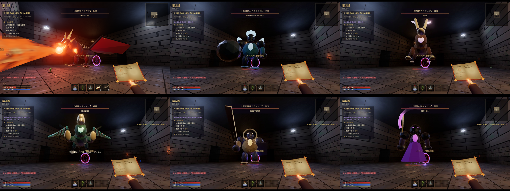

# 属性の守護者：調査・戦闘仕様・検証

更新: 2026-11-11。モデルと動作は独自のプロシージャル実装。数値は難度を上げるための調整案であり、初見プレイヤーによるバランス検証は未実施。

## 設計と出典

- [Capcom: Animating the Monsters of Sunbreak](https://news.capcomusa.com/2023/04/07/animating-the-monsters-of-sunbreak/): リードアニメーターの山崎氏は、モンスターの個性と動物らしさ、ゲーム内での動作・VFXの調整、出始めの動作から技と反撃の隙を読めることを説明。本作では技ごとの構え、体重移動、種族別の移動、振り抜き後の隙に反映した。
- [fvillalva: Dragon energy beam](https://realtimevfx.com/t/dragon-energy-beam/5024): 作者による制作過程と更新。頭への追従、発射前後の効果、消散についての議論を参考にした。本作の炎は自作シェーダー・粒子で、素材の流用はしていない。
- [Mike Stout: Boss Battle Design and Structure](https://www.gamedeveloper.com/design/boss-battle-design-and-structure) と [Enemy Attacks and Telegraphing](https://www.gamedeveloper.com/design/enemy-attacks-and-telegraphing): 何の技能を試すか、攻撃前の合図、学習と複雑化を設計する。本作で試す技能は位置取り・回避・詠唱開始のタイミング。
- [Mike Birkhead: Boss Design — Tips From a Combat Designer](https://www.gamedeveloper.com/design/opinion-boss-design---tips-from-a-combat-designer): シルエット、予備動作、反撃の機会を設計する考え方を参照。

参考動画: Monster Hunter公式の[ミラボレアス](https://www.youtube.com/watch?v=7p8Edk23dRk)、[ムフェト・ジーヴァ](https://www.youtube.com/watch?v=SHKZu20X9Vo)、GDCの[Boss Up](https://www.youtube.com/watch?v=48Ymh4Ge5j8)。公開タイトルと出所を確認した参考リンクであり、動画全編を分析したとはしていない。

## 六種類の守護者

| 層 | 属性・ボス | ソロHP | 移動 | 知って対処する仕掛け |
|---|---|---:|---|---|
| 1 | 炎鱗竜ヴォルグ | 3,200 | 翼で跳び、脚を畳んで着地 | 吸い込み中〜吐き始めの頭部へ弾を当てると暴発し、3.8秒の弱点露出 |
| 2 | 氷冠巨人ニヴァリス | 3,680 | 重心を左右に移す重い歩行 | 22m以内で2.5秒静止すると凍気が最大になり、毎秒6ダメージと鈍足。移動して振り払う |
| 3 | 雷角獣ヴァジュラ | 4,160 | 四肢を縮めて低く跳躍 | 構え・攻撃中は術の威力45%、8ダメージを反射。放電する移動・反撃時間に撃つ |
| 4 | 嵐翼グリフォン | 4,640 | 羽ばたき、脚を畳んで飛び移る | 8mより遠い術は威力30%。懐に入るか、大技後を狙う |
| 5 | 聖堂騎像アウレリア | 5,120 | 盾を構えた踏み込み | 正面の術は威力25%。側面・背後へ回るか、弱点露出を狙う |
| 6 | 深淵の死神ノクス | 5,600 | 霧に消えて再出現 | 構え・攻撃中、10m以内では鎖に捕らわれ毎秒6ダメージ、ボスが18回復。距離を取る |

第7〜9層は炎・氷・雷が強化されて再登場。第10層は終章の死神（ソロHP12,220）。各層で15%、追加人数ごとに60%のHP増加。攻撃ダメージには1層ごとに2.5%（最大50%）の深層補正。特定の属性を入手しないと突破できない仕掛けにはしない。

炎の暴発は継続ダメージでは発生しない。雷の反射も継続ダメージは対象外。死神が姿を消している短い間は新しい直撃を避けるが、付着済みの燃焼・毒は続く。凍気や吸収はホストが判定し、遠隔プレイヤーのダメージは既存の所有者宛て通知を使う。

## 攻撃と学習

床の扇・円による予測表示と、攻撃前の回避方向案内を撤去。技名は発動時、攻略上の状態はHUDと失敗時の短い表示で伝える。対象位置や向きは構え始めに固定し、振り抜き中に安全地帯を追尾しない。

以下は炎竜の基準値。各属性で威力・射程・反撃時間・攻撃順が変わる。

| 技 | 構え | 発動 | 反撃時間 | 基準ダメージ・範囲 |
|---|---:|---:|---:|---|
| 薙ぎ払う劫火 | 2.4秒 | 1.8秒 | 1.8秒 | 52＋燃焼、28m。半角20度の炎を左右へ薙ぐ |
| 旋回尾撃 | 1.65秒 | 1.35秒 | 1.5秒 | 48、4〜16m。尾が通過する角度だけを判定 |
| 崩山の叩きつけ | 1.9秒 | 1秒 | 3.4秒 | 64、前方17m。振り下ろしに衝撃判定 |
| 墜ちる竜星 | 2.2秒 | 1秒 | 3.8秒 | 70、半径6.5m。構え始めにいた地点へ落下 |

各技の間には種族別の移動（1.1〜1.65秒）。初層の平均攻撃間隔は約7.4秒。HP半分以下で攻撃順が6手に変わり、構えは86%、反撃時間は85%になる。単純なランダム連打ではなく、順番と構えを覚えて回復・詠唱の時間を選べる。弱点露出中は被ダメージ1.6倍。

命中は発動直後ではなく、実際の吐息・回転・着地の時刻に合わせる。各技は各人に1回だけ命中。低fpsでも前フレームからの尾の回転角を調べ、通過を取り落とさない。

## 見た目と移動

炎竜は全長約20m・翼開長約22m・高さ約10m。氷巨人、四足の雷獣、羽根の翼と鉤嘴を持つグリフォン、剣盾の石像、大鎌とローブの死神には別のモデルとリグを用意した。制作途中のローポリモデルで、専用の完成済みBlenderアニメーションではない。

竜の移動は最大2.6m、グリフォンは3.2m、雷獣は1.8mの上昇弧を持つ。水平位置も同じ進行度で補間し、空中の見た目だけをその場で動かさない。死神は移動の中央部分で消え、出発・到着地点の霧で移動を示す。足運び、翼、重心、着地の砂煙と音を種族ごとに変える。

炎は口に追従する3層の乱流シェーダー、流れる炎塊、白熱芯、火の粉、周辺照明、吐き終わりの残火を組み合わせる。実画面で白飛びしたため、芯を細くし、外炎を通常合成にして明るさを抑えた。氷には飛ぶ結晶、雷には折れ曲がる放電、死神には吸収の鎖が付く。床の予測マーカーは再導入しない。

戦場は36m四方・天井16mの広間。中央から3.5mまで移動する。家具・床罠・通常敵の初期配置を避ける。頭・首・胴・脚の動く形状に術が当たり、空中や高い頭を狙った弾も広間の天井まで到達する。

## 音声認識の修正（このPRの既存変更）

- Vosk／Whisperの遅延停止を、新しいV入力でキャンセル。
- マイク許可待ち中にVを離した場合、許可完了後に勝手に録音を開始しない。準備中の重複初期化も防ぐ。
- Whisperの録音セッションと推論要求を区別し、前の詠唱の返答や重複返答を破棄。
- Web SpeechからVoskへ切り替える際も押下状態を引き継ぎ、準備中にWhisperが割り込まない。

同音語辞書・あいまい一致の閾値・モデル自体は変更していない。認識結果の取りこぼし・混入を招く制御の修正。

## 検証

`npm test`: 29件。音声の非同期制御、120通りの迷宮生成、命中時間・回転範囲、ホスト／参加者の役割分離、6種類のモデルの全姿勢・移動高度、頭部への実弾命中、反射・暴発の実ダメージ処理、対策の分岐を確認。

Windowsの実Electronで第1〜6層のモデル・名前・HPを確認。専用セーブ領域でボス前へ配置し、通常敵は検証時だけ停止。移動と文字詠唱はキーコード付きイベントで入力している。

高難度版の連続戦闘で、ブレス被弾後の回復、尾撃・叩きつけ・竜星の回避、ファイアランスの反撃を実ゲームループで確認。回復入力を誤った試行では次の攻撃で全滅した。成功試行ではプレイヤーHP100→約38→約54、ボスHP3,200→約3,010。途中でHPを書き換えずに録画。初見の手動プレイや討伐成功の証明ではない。

旧版（HP640）の実機検証では討伐・戦利品・HUD消去・第2層への転移まで確認済み。現行の高HP版について全属性での討伐、実マイクの認識率、複数PCのLAN同期、長時間の性能測定は未実施。

次のプレイテストでは、各属性の初期魔法での討伐時間・魔力切れ、実マイクの認識待ちを含む反撃時間、初見で攻略条件を理解できるか、反射や凍気が理不尽になっていないかを確認する。

追加の実画面確認: 竜の上昇2.58m、雷獣1.73m、グリフォン3.09mを計測。死神の移動中の非表示と再出現を確認。死神の8m以内ではプレイヤーHP100→94、ボスHP5,500→5,518。16mへ離れると両者の値が変化せず、吸収停止を確認。捕捉したJavaScript実行時エラーは0件。

Web配布物は272ファイルでビルド成功。public/jsの50ファイルを構文解析し、変更した11ファイルのdocs/jsとの一致を確認。録画は実際のElectron描画とゲーム内音声のみ（マイク・他アプリの音声は含まない）。戦闘映像は約30秒、別ボスの移動紹介は約21秒。後者は各階への配置とHPのリセットを含む動作確認用。
