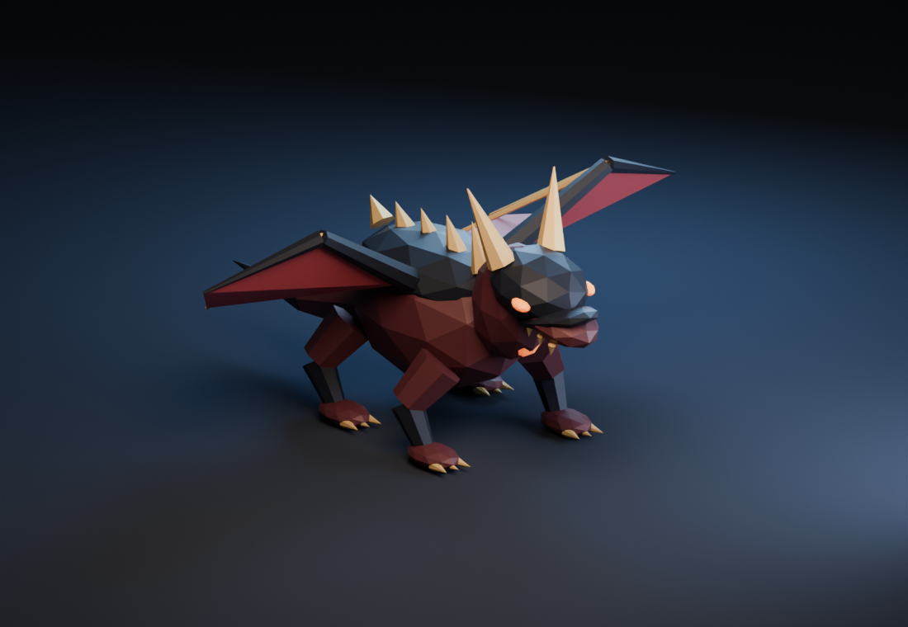

# 詠灰竜ヴォルグ：調査と実装判断

調査日: 2026-11-11。数値はARCANA VOX用の初期仮説であり、面白さや実マイクの認識精度を実証した値ではない。

画像は `dragon-model.js` の実際の頂点と色をBlenderで描画した形状確認用。ゲーム内の照明や画面のスクリーンショットではない。

## 調べたこと

- Mike Stout（ゲームデザイナー）[Boss Battle Design and Structure](https://www.gamedeveloper.com/design/boss-battle-design-and-structure): ボスで試すプレイヤースキルを先に決め、序盤の学習から段階的に複雑化する構成を説明している。今回は「詠唱を止めて回避する判断」「大技後に長い詠唱を通す判断」を試す。
- Mike Stout [Enemy Attacks and Telegraphing](https://www.gamedeveloper.com/design/enemy-attacks-and-telegraphing): 攻撃前の動作・音・効果を組み合わせ、プレイヤーが何に対処するかを伝える。今回は翼と顎の構え、床の扇／円、音、文字の回避案内を併用する。色だけに頼らない。
- Mike Birkhead（当時Vigil Gamesのシニアデザイナー）[Boss Design — Tips From a Combat Designer](https://www.gamedeveloper.com/design/opinion-boss-design---tips-from-a-combat-designer): シルエット、予備動作、弱点を見せる時間の設計を扱う。今回は首・角・翼・尾を備える独自モデルと、逆鱗が明るくなる反撃時間に反映した。記事の推奨タイミングをそのまま流用せず、声を使うゲームに合わせて長めに設定する。

## 戦闘の流れ

各層の門番と3層ごとの主をドラゴンに置き換える。最終層は「終章の詠灰竜」。古い主の実装は残すが、生成しない。

| 技 | 予兆 | 判定 | 反撃時間 | 対処 |
|---|---:|---|---:|---|
| 灼熱の息 | 2.2秒 | 半角30度、14mの扇 | 6秒 | 向きが固定されたら横か背後へ |
| 尾の薙ぎ払い | 1.8秒 | 半径4.5mの円 | 5.5秒 | 円の外へ移動 |
| 竜星 | 2.4秒 | 予兆時の対象地点、半径2.6m | 6秒 | 足元の円から移動 |

HP50%以下で竜星を通常ローテーションへ追加。前半も、ブレス射程外の相手には竜星で応じる。予兆中は竜も照準も止まり、回復中は追加攻撃しない。逆鱗露出中は既存の脆弱補正を使って被ダメージ1.6倍。すべての初期属性が通り、特定の言霊を拾わないと勝てない条件を設けない。

初層ソロHPは640。層ごとに15%、追加人数ごとに60%増加。攻撃の基礎ダメージは20〜30で、深層補正は最大1.5倍。ソロで成立する回避と反撃を基本とし、協力は既存の合唱2.2倍を狙える。竜には人数必須の結界や、旧門番のランダム隕石を重ねない。

戦場は開始部屋以外の平らで3×3セル以上の部屋を優先し、内部の柱を除去する。床罠・家具・通常敵の初期配置を避ける。翼を広げたモデルも通常の天井高さ6.4mに収まる。

ホストだけがAIと命中を判定する。参加者へ10Hzの敵状態に予兆の位置・向き・残り時間・最大HPを同梱し、途中参加時も進行中の状態を描ける。ダメージは既存の所有者宛て通知を使う。通信往復遅延の大きい環境で予兆が短く感じないかは実機で確認が必要。

## 音声認識の修正

- Vosk／Whisperの遅延停止を、新たなV入力でキャンセルする。
- Whisperのマイク許可待ち中にVを離した場合、許可完了後に勝手に録音を開始しない。準備中の重複入力で複数のマイク処理を作らない。
- Whisperは録音セッションと推論要求を区別し、前のV詠唱の遅延返答と重複返答を捨てる。処理中フラグは未完了要求すべてを数える。
- Web Speechのネットワーク障害でVoskへ切り替える際、押し続けているV入力を引き継ぐ。Vosk準備中にWhisperが割り込まない。

同音語辞書、あいまい一致の閾値、音声モデル自体は変更していない。今回の改善は聞き取り結果の取りこぼし・取り違えを招く制御上の不具合が対象。

## 検証と次のプレイテスト

`npm ci --ignore-scripts` 後に `npm test`（Node.js 22以上）。実装を使った偽マイク・認識結果の非同期テスト、戦闘状態遷移、当たり判定、ホスト／参加者の役割分離、120通りの迷宮生成、モデル寸法を確認する。Web配布物は `npm run build-web` で更新する。

実行結果: 19件成功。音声10件のうち8件は変更前の `fac3dc4` で失敗し、修正後に成功した。全 `public/js` の構文解析、変更したWeb配布物10ファイルの一致、Webビルドも確認済み。

実画面でのプレイ、実マイク、複数PCでのLAN接続は別途必要。今回の実行環境ではブラウザーからローカルゲームへ接続できず、実画面の確認は未完了。

1. 初見ソロで、予兆を見て回避方向を説明できるか。各初期属性で初層の討伐時間・被弾回数・魔力切れを測る。
2. 大技後の6秒で、実際に完全詠唱を1回通せるか。音声認識の待ち時間も含めて確認する。
3. 二人で別方向から回避し、反撃時間に合唱できるか。一人が倒れても戦闘が継続できるか。
4. Vの連打・マイク許可中のキー解放・遅いWhisper・常時詠唱・途中参加で、重複発動や予兆欠落が起きないか。
5. 長時間の録音、実ノイズ、同音語、分割認識の代表音声を集め、誤発動率・取りこぼし率・確定遅延を比較する。合成音だけでは認識精度の改善を判定しない。
